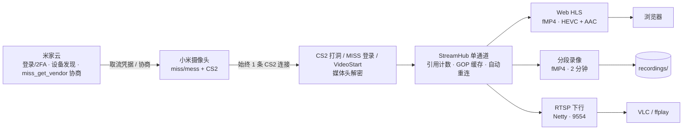

# iNvr · 小米摄像头 NVR

> 纯 Java 自研的小米摄像头网络录像服务（NVR）。通过小米私有 **miss/mess + CS2** 协议直连接入摄像头，向下提供 **Web 实时预览、标准 RTSP、分段录像、时间轴回放**；同一摄像头无论被多少路预览 / 录像 / RTSP 使用，**只占用 1 条上游连接**。

`Java 17` · `Spring Boot 3` · `Netty` · `JavaCV(FFmpeg)` · 无外部流媒体进程 · 无需刷固件

---

## 功能特性

- **私有协议直连**：仅走小米统一的 miss/mess + CS2 协议（适用于 2020 年后机型），不需要摄像头开启 RTSP/ONVIF，也不依赖云录像；不做 legacy / TUTK 老协议。
- **单通道复用（核心）**：`StreamHub` 以引用计数方式做扇出，网页预览、RTSP 拉流、分段录像任意组合，对摄像头始终只建立 **1 条 CS2 连接**；内置 GOP 缓存（拉流秒开）、有界队列背压与断流自动重连。
- **米家账号登录**：Web 端完成登录，支持图形验证码、短信 / 邮箱二次验证（2FA）；会话凭据 AES-GCM 加密本地存储，重启免密恢复。
- **Web 全流程控制台**：设备列表、在线 / 离线状态、一键实时预览、一键录像、录像管理、时间轴回放，单页完成。
- **实时预览**：HLS over **fMP4（CMAF）**，视频 HEVC/H.264 原样、音频转 AAC，浏览器原生播放（无需插件），约 2–4 秒延迟。
- **标准 RTSP 下行**：用 Netty 手写 RTP-over-TCP 服务，`rtsp://主机:9554/<did>`，VLC / ffplay / 第三方播放器直接拉流（H265 / H264 + Opus）。
- **分段录像**：fMP4（CMAF）默认 **2 分钟一段**、按 IDR 边界对齐；**边录边播**（写入中的片段也能播放），崩溃 / 断电只丢最后约 1 个 GOP，不整段报废。
- **时间轴回放**：按天时间轴展示录像段，点击任意位置连续播放，支持缩放与翻页。
- **持续录像持久化**：一旦点击"开始录像"，服务重启 / 崩溃后会自动续录，只有显式停止才结束。
- **访问安全**：访问密码门禁（PBKDF2WithHmacSHA256 加盐哈希），支持 URL 一键解锁（适合受信内网）；会话与密码均加密落盘。
- **共享看板（免登录大屏）**：管理员配置 4 / 9 / 6（1 大 5 小）宫格与摄像头，生成免鉴权共享链接，可直接配置到 Android TV 或浏览器无人值守展示，支持多台电视同时打开、设置链接过期；外部事件系统通过 Webhook 驱动事件摄像头全屏（6 宫格进大格），60 秒后自动复原。共享取流复用同一 HlsSink，上游仍只占 1 条连接。

---

## 界面预览

### 访问密码门禁

首次登录米家账号后设置访问密码，之后每次打开都需要解锁；也可生成一次性 / 一键解锁链接。


### 设备列表与在线状态

自动发现账号下的摄像头，展示型号、局域网 IP、在线 / 离线徽标，以及实时预览、开始录像入口。


### 网页实时预览

浏览器原生 HLS 播放，HEVC 高清画面；弹窗内同时给出 RTSP 地址，可复制到 VLC / ffplay 拉流。


### 录像文件

2 分钟一个 fMP4 分段，支持在线播放、下载、删除，可按摄像头筛选；正在写入的分段才标记"录制中"。


### 时间轴回放

按天时间轴，青色块即录像段，红色游标为当前位置；点击任意录像段自动连续播放，显示分段进度。


---

## 工作原理

整体上行只走小米私有协议，下行在 `StreamHub` 处做单通道扇出：



无论网页预览、RTSP、录像同时开多少路，`StreamHub` 对同一摄像头只维持一条上游连接；最后一个消费者退出后自动释放并在需要时重连。

---

## 快速开始

### 环境要求

- JDK 17 或以上（JDK 21 亦可）
- Maven（仓库内置 `maven-settings.xml`，走阿里云镜像，不污染全局配置）

### 构建

```bash
mvn -s maven-settings.xml package
# 产物：target/invr.jar（fat jar，已内嵌 FFmpeg native，无需另装流媒体服务）
```

### 启动 Web 服务

```bash
java -jar target/invr.jar
```

浏览器打开 `http://<主机IP>:9080`：

1. 首次进入在页面登录米家账号（图形验证码 / 短信验证码按提示完成）；
2. 登录成功后设置访问密码并进入系统；
3. 在「摄像头」页点击 **实时预览** 看画面，或点击 **开始录像** 持续录像；
4. 在「录像回放」页通过时间轴回看历史录像。

### 用 RTSP 拉流

Web 服务启动后，内嵌 RTSP 服务同时就绪（默认 `9554`），第三方播放器直接打开：

```
rtsp://<主机IP>:9554/<摄像头DID>
例如：rtsp://192.168.1.10:9554/1190193414
```

### 配置共享看板（免登录大屏）

1. 在控制台「共享看板」页新建看板，选择布局（4 / 9 / 6 宫格）并按槽位分配摄像头，可设置过期时间（留空永久有效）；
2. 复制生成的**共享链接**，直接配置到 Android TV 浏览器或任意浏览器，无需登录即可长时间展示，同一链接可同时开在多台电视上；
3. 看板同时提供独立的 **Webhook 密钥**，外部事件系统在摄像头有事件时调用：

```bash
curl -X POST "http://<主机IP>:9080/share-event" \
  -H "X-Share-Secret: <webhookSecret>" \
  -H "Content-Type: application/json" \
  -d '{"did":"1190193414","eventType":"motion"}'
```

事件摄像头在 4 / 9 宫格下全屏展示、6 宫格下进入大格（与默认主摄像头单次交换），默认 60 秒后自动复原；窗口内新事件直接覆盖并重新计时。

### 常用配置

在 `src/main/resources/application.yml` 中调整，或用命令行参数覆盖：

| 配置 | 默认值 | 说明 |
| --- | --- | --- |
| HTTP 端口 | `9080` | Web 控制台与 API |
| RTSP 端口 | `9554` | 内嵌 RTSP 下行 |
| 录像目录 | `recordings` | fMP4 分段存放目录 |
| 分段时长 | `120`（秒） | 每个 fMP4 片段时长，按 IDR 对齐 |
| HLS 分片 | `2` 秒 / 窗口 `6` | 网页预览延迟与缓存 |
| 音频转码 | `true` | HLS 把 Opus 转 AAC，失败自动降级静音 |
| 事件持续 | `60`（秒） | 共享看板事件画面时长，到期复原 |
| SSE 心跳 | `15`（秒） | 维持事件长连接 |
| 大屏兜底重载 | `3600`（秒） | 展示页定时重载，`0` 关闭 |
| 配置轮询 | `60`（秒） | 展示页配置/设备状态兜底轮询 |

示例：

```bash
java -jar target/invr.jar --server.port=8080 --invr.rtsp-port=8554
```

### 数据与存储

- **数据目录**默认在程序运行目录下的 `.invr/`（会话密钥、访问密码、录像状态等），录像默认在运行目录下的 `recordings/`，随程序目录一起迁移。
- 可用 `-Dinvr.data.dir=<目录>` 或环境变量 `INVR_DATA_DIR` 指定数据目录；
- 海外区域设置环境变量 `INVR_REGION`（de / i2 / ru / sg / us），默认中国区 `cn`。

### CLI 调试（可选）

CLI 入口 `com.invr.InvrApplication` 主要用于协议调试，可通过 Maven exec 运行：

```bash
mvn -s maven-settings.xml exec:java -Dexec.args="devices"        # 列出摄像头
mvn -s maven-settings.xml exec:java -Dexec.args="stream <did> 30" # 裸流落盘自检
```

---

## 工程结构

```
src/main/java/com/invr/
├── cloud/    # 米家云：登录(验证码/2FA)、业务 API 签名、设备发现、miss_get_vendor 协商
├── crypto/   # RC4 / X25519 / ChaCha20 等加解密
├── p2p/      # CS2 UDP 打洞、TCP 传输、DRW 帧、DataChannel 重组
├── miss/     # MISS 登录、加密命令、VideoStart 取流
├── hub/      # StreamHub 单通道扇出（引用计数 / GOP 缓存 / 自动重连）
├── codec/    # 码流解析（Annex-B / AVCC、参数集等）
├── hls/      # HLS fMP4(CMAF) 输出（HEVC + AAC）
├── rtsp/     # Netty 手写 RTSP 下行（RTP-over-TCP）
├── record/   # fMP4 分段录像（边录边播 / 崩溃保全 / 分段接续）
├── store/    # 会话、访问密码、录像状态的本地加密存储
├── web/      # Spring Boot 控制台、REST API、门禁、静态页面
└── model/    # 设备 / 连接参数模型
```

---

## 支持范围与说明

- 适用于 **2020 年之后采用统一协议（miss/mess + CS2，vendor=4）的小米 / 米家摄像头**；真机验证机型为 `xiaomi.camera.c302`（H.265 3.5K + Opus）。
- 不支持 legacy / TUTK 老机型，也不做 RTSP / ONVIF 上行接入。
- 摄像头固有约分钟级的断流，由自动重连与 GOP 缓存兜底，无需人工干预。

## 合规与免责

- 本项目**仅用于接入本人自有摄像头，并在局域网 / 受信网络内使用**，请勿用于监控他人或违反当地法律法规。
- 这是一个**非官方逆向协议实现**，不提供任何可用性保证；小米云端或固件升级可能导致协议失效，需自行评估使用风险。
- 协议实现参考了 [go2rtc](https://github.com/AlexxIT/go2rtc)（MIT，仅作协议蓝本）与 MiBeeNVR 的架构思路（AGPL-3.0，未直接使用其代码）。

## 相关文档

- 详细设计文档：[`docs/design/01-xiaomi-protocol-design.md`](docs/design/01-xiaomi-protocol-design.md)
- 共享看板设计文档：[`docs/design/02-shared-board-design.md`](docs/design/02-shared-board-design.md)
- 早期 M1 阶段说明（已归档）：[`docs/README-M1.md`](docs/README-M1.md)
